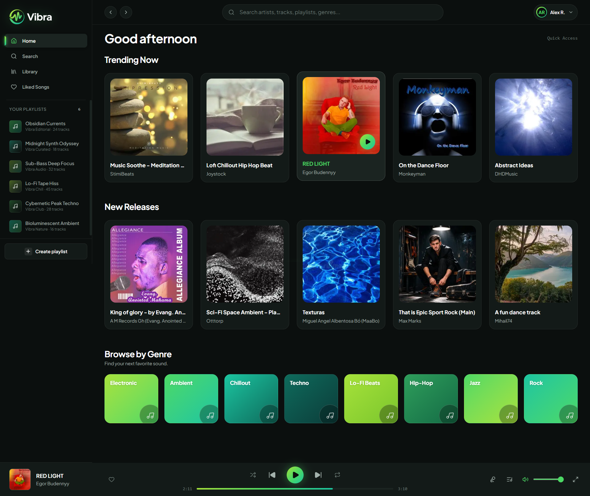
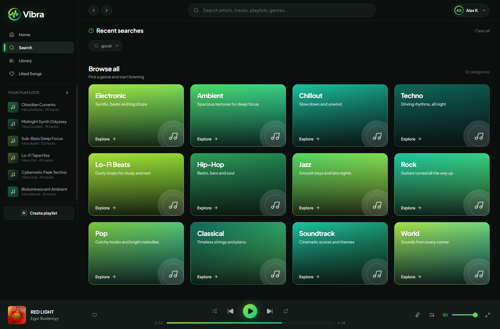
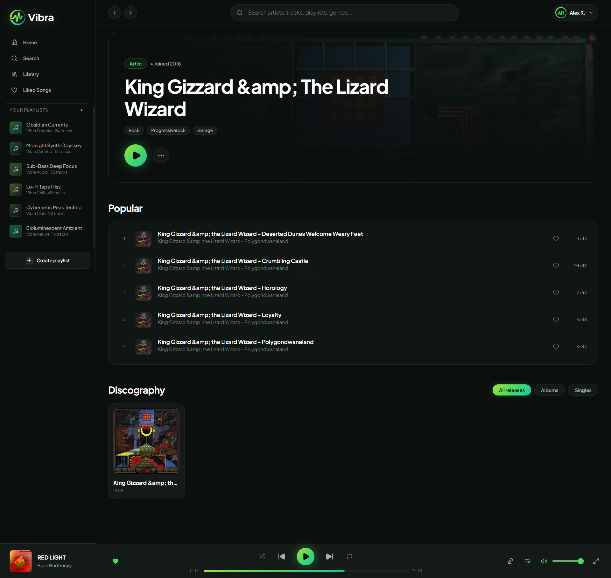
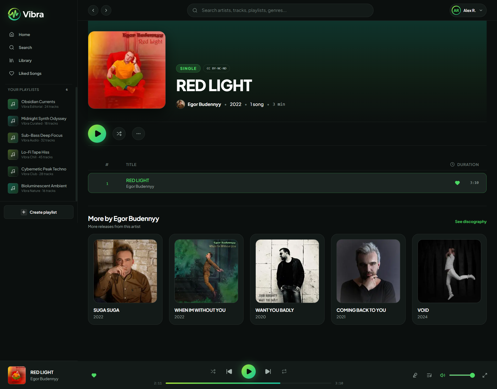
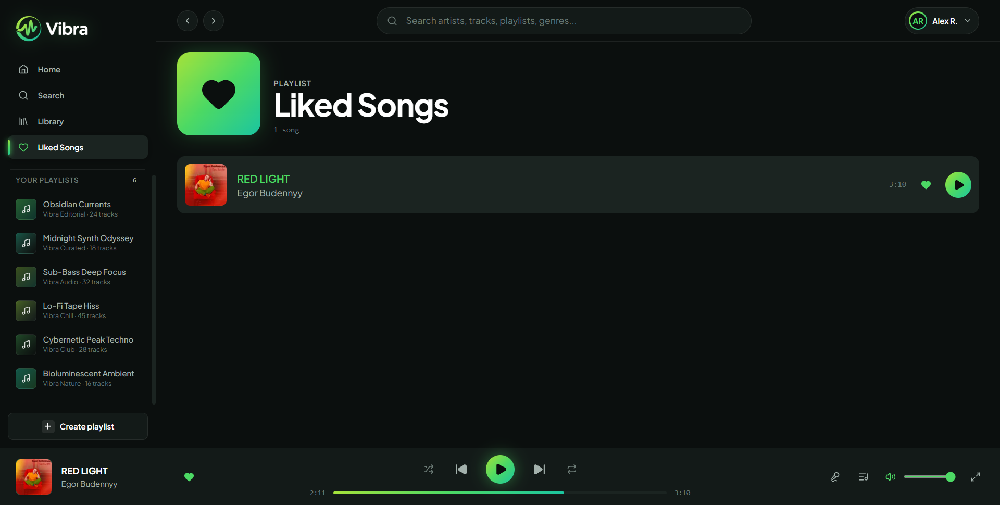
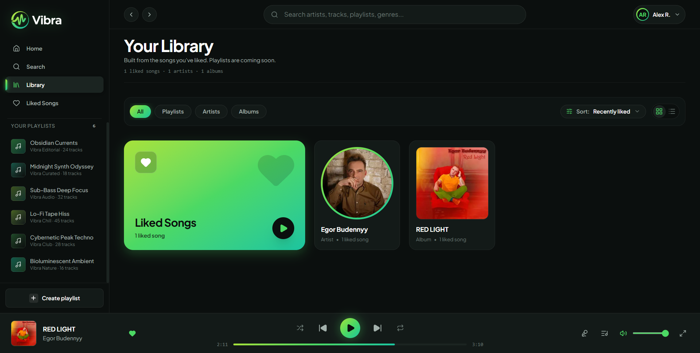

# 🎵 Vibra – Music Streaming Web App

Vibra is a modern music streaming web application built with Next.js, React, and TypeScript. It provides an immersive music listening experience where users can discover tracks, explore artists and albums, browse music by genre, and manage their personal music library.

The application integrates with the **Jamendo Music API** to fetch music data and stream audio, featuring a custom-built audio player with playback controls and interactive features.

> 🚧 **Work In Progress (WIP)**
>
> Vibra is currently under active development. New features, UI improvements, and functionality are being added. Some features may be incomplete or subject to change.

---

# 🚀 Live Demo

🔗 **Live Website:** [Live@Vercel](https://music-player-iota-eight-91.vercel.app/)

---

# 📸 Project Screenshots

## 🏠 Home Page



---

## 🔍 Search Page



---

## 🎤 Artist Page



---

## 💿 Album Page



---

## ❤️ Liked Songs



---

## 📚 Music Library



---

# ✨ Features

### 🎶 Music Discovery

- Discover featured and trending tracks.
- Explore newly released music.
- Browse music by different genres.
- Explore recommended tracks.
- Discover popular artists and albums.

### 🔍 Search Functionality

- Search for songs.
- Search for artists.
- Search for albums.
- Search for playlists.
- Filter search results by category.
- Save and access recent searches.

### 🎧 Custom Music Player

- Play and pause tracks.
- Skip to the next or previous track.
- Shuffle playback.
- Repeat playback.
- Interactive progress and seek bar.
- Volume control and mute functionality.
- Display current track and artist information.
- Up Next queue.
- Animated equalizer while playing.

### ❤️ Personal Music Library

- Like and unlike songs.
- View liked songs.
- Browse liked artists and albums.
- Filter library content by category.
- Sort library items.
- Persist liked songs using browser Local Storage.

### 🎤 Artist & Album Exploration

- Artist profile pages.
- Artist biographies and information.
- Popular tracks.
- Artist discography.
- Album details and track listings.
- Discover similar artists.
- Explore more albums from an artist.

### 📱 User Interface

- Modern dark-themed interface.
- Responsive layouts.
- Smooth loading skeletons.
- Interactive navigation.
- Clean and intuitive music browsing experience.

---

# 🛠️ Tech Stack

### Frontend

- Next.js 16
- React 19
- TypeScript
- Tailwind CSS 4
- Lucide React

### API & Data

- Jamendo Music API
- Next.js API Routes
- Fetch API

### State Management & Browser Storage

- React Context API
- React Hooks
- Local Storage

---

# 🎼 Music API Integration

Vibra uses the **Jamendo Music API** to retrieve music-related information and audio streams.

The API provides:

- Track information and audio URLs.
- Artist information.
- Album information.
- Music genres and tags.
- Playlist search results.
- Popular and trending tracks.

API requests are handled through server-side utility functions to keep the Jamendo client ID out of browser-side code.

---

# 📂 Project Structure

```bash
MusicPlayer/
│
├── public/
│   └── assets/
│
├── src/
│   ├── app/
│   │   ├── album/
│   │   ├── artist/
│   │   ├── api/
│   │   ├── genre/
│   │   ├── library/
│   │   ├── liked/
│   │   ├── search/
│   │   ├── globals.css
│   │   ├── layout.tsx
│   │   └── page.tsx
│   │
│   ├── components/
│   │   ├── album/
│   │   ├── artist/
│   │   ├── home/
│   │   ├── library/
│   │   ├── search/
│   │   ├── PlayerBar.tsx
│   │   ├── PlayerProvider.tsx
│   │   ├── Sidebar.tsx
│   │   ├── TopBar.tsx
│   │   └── TrackList.tsx
│   │
│   ├── lib/
│   │   ├── jamendo.ts
│   │   ├── library.ts
│   │   ├── genres.ts
│   │   ├── mock-data.ts
│   │   └── utils.ts
│   │
│   └── types/
│       └── music.ts
│
├── .gitignore
├── package.json
├── next.config.ts
└── README.md
```

---

# ⚙️ Installation & Setup

Follow these steps to run Vibra locally.

### 1. Clone the Repository

```bash
git clone https://github.com/AljuSabu/MusicPlayer
```

### 2. Navigate to the Project Directory

```bash
cd MusicPlayer
```

### 3. Install Dependencies

```bash
npm install
```

### 4. Configure Environment Variables

Create a `.env.local` file in the project root directory.

```env
JAMENDO_CLIENT_ID=YOUR_JAMENDO_CLIENT_ID
```

You can obtain a Jamendo API client ID from the [Jamendo Developer Portal](https://developer.jamendo.com/).

**Important:** Keep your API credentials private. Do not commit `.env.local` to GitHub.

### 5. Start the Development Server

```bash
npm run dev
```

Open your browser and visit:

```text
http://localhost:3000
```

### 6. Build for Production

```bash
npm run build
```

To start the production server:

```bash
npm run start
```

---

# 💾 Data Persistence

Vibra currently uses browser Local Storage for certain user-specific features.

- Liked songs are stored locally.
- Recent searches are stored locally.
- Liked songs remain available after refreshing the browser.

There is currently no dedicated user account or cloud database system for synchronizing personal libraries across devices.

---

# 📚 Key Learning Outcomes

This project demonstrates practical experience with:

- Next.js App Router.
- React Context API for global audio player state.
- TypeScript and reusable components.
- Server-side API integration.
- Dynamic routing and route parameters.
- Audio playback using the HTML Audio API.
- React Hooks and custom hooks.
- Browser Local Storage.
- Search and filtering functionality.
- Loading states and Suspense.
- Responsive UI development.

---

# 🚧 Future Improvements

Planned improvements include:

- User authentication and profiles.
- Cloud-based music library synchronization.
- Personal playlist creation and management.
- Follow artists functionality.
- Listening history.
- Personalized recommendations.
- Improved queue management.
- Mobile UI and player enhancements.

---

# 👨‍💻 Author

**Alju Sabu**

- GitHub: [AljuSabu](https://github.com/AljuSabu)

---

# 📌 Project Status

<ins>Work In Progress (WIP)</ins>

Vibra is an ongoing project. Development is focused on improving the music discovery experience, enhancing playback functionality, and introducing additional features.

---

⭐ If you like this project, consider giving it a star on GitHub!
